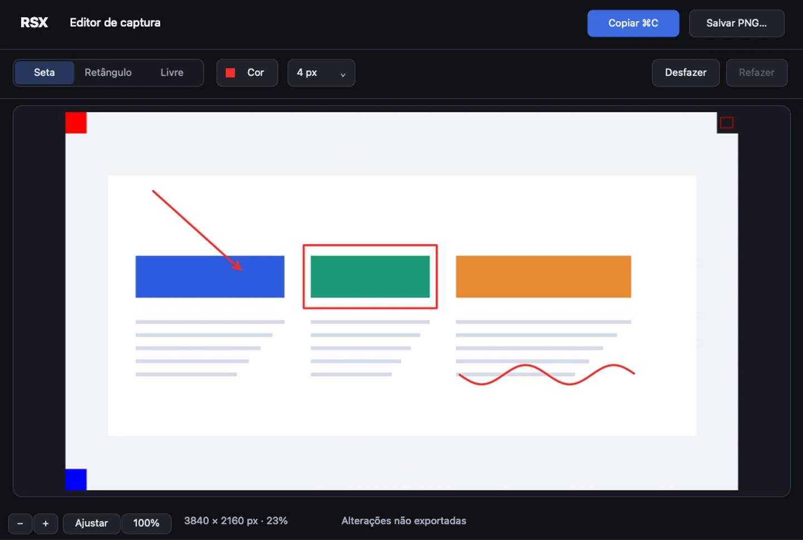
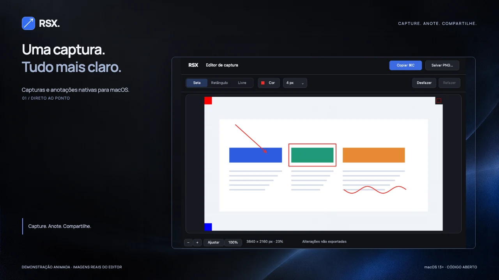

# RSX

### Mostre o que você quer dizer.

Uma boa captura vale mais que uma longa explicação. O **RSX** é um aplicativo de capturas de tela e anotações para macOS: capture, destaque o que importa e compartilhe uma imagem que deixa sua ideia clara.

**Gratuito · Código aberto · macOS 13+**

[Baixar para macOS](https://github.com/pedroaba/rxs/releases) · [Conhecer o aplicativo](https://github.com/pedroaba/rxs) · [Enviar uma sugestão](https://github.com/pedroaba/rxs/issues)

## Menos explicação. Mais clareza.

Um ajuste no layout. Um detalhe que passou despercebido. Uma ideia que precisa sair da sua tela e chegar a outra pessoa.

Com o RSX, você pode mostrar exatamente o que quer dizer:

- **Capture o que importa.** Escolha a tela inteira, uma região ou uma janela.
- **Direcione o olhar.** Use setas, retângulos e desenho livre para destacar informações.
- **Cuide dos detalhes.** Ajuste cores, opacidade e espessura dos traços, com seus tons favoritos sempre à mão.
- **Mantenha o ritmo.** Configure atalhos globais e use desfazer e refazer durante a edição.
- **Compartilhe com clareza.** Copie ou salve em PNG, preservando a resolução original da imagem.

## Na sua tela. No seu Mac.

A captura, a edição e a exportação acontecem no seu dispositivo. O RSX não envia suas capturas para servidores e não tem upload ou sincronização.

É um aplicativo nativo para macOS, disponível pela barra de menus, com código aberto para você conhecer e acompanhar.

## Veja o RSX em ação

[Assistir à demonstração de 25 segundos](https://github.com/pedroaba/rxs-lp/blob/main/public/media/rsx-demo.mp4) · [Ver a versão rápida de 8 segundos](https://github.com/pedroaba/rxs-lp/blob/main/public/media/rsx-short.mp4)

As demonstrações são animações feitas com imagens reais do editor. O aplicativo não oferece gravação de vídeo ou GIF.

## Comece com o RSX

Escolha o arquivo correspondente ao seu Mac na [página de downloads](https://github.com/pedroaba/rxs/releases): **Apple Silicon** ou **Intel**. O requisito mínimo é **macOS 13 ou posterior**.

Descompacte o ZIP, mova o aplicativo para **Aplicativos** e autorize a **Gravação de Tela** quando solicitado. Depois, configure seus atalhos pela barra de menus.

Na versão pública 0.3.0, os arquivos e o aplicativo ainda usam o nome **RXS**. Os pacotes não possuem notarização da Apple; se o macOS bloquear a primeira abertura e você confiar na origem do download, siga as orientações nas [notas da versão](https://github.com/pedroaba/rxs/releases/tag/v0.3.0).

## Sobre esta página

Este repositório reúne a landing page do RSX, suas imagens e demonstrações. O desenvolvimento do aplicativo acontece no [repositório do RSX](https://github.com/pedroaba/rxs).

Para contribuir com o site, consulte o [guia de desenvolvimento](docs/development.md).

---

**Capture. Anote. Compartilhe.**

Um projeto de [Pedro Barbosa](https://github.com/pedroaba).
